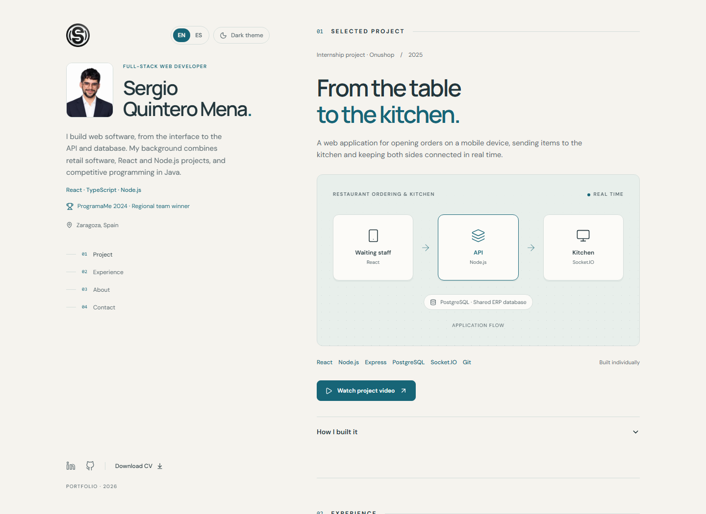

# Sergio Quintero Mena — Portfolio

[Visit the portfolio](https://portfolio-plum-six-30.vercel.app/) ·
[English](https://portfolio-plum-six-30.vercel.app/?lang=en) ·
[Español](https://portfolio-plum-six-30.vercel.app/es/)

A bilingual portfolio built with **React, TypeScript, Tailwind CSS and Vite**.
It presents my retail software experience, restaurant ordering and kitchen
project, competitive programming background and contact details.



The screenshot is generated from the local production build. The live site may
lag behind unreleased changes in this repository.

## Run locally

Use **Node.js 24** (see `.nvmrc`) and npm. Dependencies are locked in
`package-lock.json`; the application requires Node.js 22.12 or later.

```sh
npm ci
npm run dev
```

Open `http://127.0.0.1:5173/`. Use `/?lang=en` for explicit English or `/es/`
for Spanish. To inspect the production output:

```sh
npm run build
npm run preview
```

The preview runs at `http://127.0.0.1:4173/`. No environment variables, database
or external API credentials are required.

## Structure

```text
src/
  main.tsx              # Entry point: resolve the page locale and mount React
  App.tsx               # Compose the page
  content.ts            # Typed English/Spanish copy and shared profile data
  components/           # Header, language/theme controls and shared presentation
  sections/             # Project, Experience, About and Contact
  hooks/                # Active section tracking with IntersectionObserver
  styles.css            # Tailwind, theme tokens, responsive and print styles
tests/                  # Browser tests against the production build
scripts/                # Reproducible image optimization and README screenshot
public/                 # Served images, CVs, sitemap and contact redirect
imagenes/               # Retained original assets from the previous site
index.html              # English metadata, language detection and fallback
es/index.html           # Spanish metadata and fallback
.github/workflows/      # Automated checks on pushes and pull requests
```

## Design decisions

- **Small, explicit components.** `App` composes the page; sections receive typed
  content as props. Theme and clipboard state stay with the controls that use
  them. There is no global state library or client-side router for this single page.
- **Two language entries.** Each has its own `lang`, title, description,
  canonical URL, language alternatives and no-JavaScript contact/CV fallback.
  `src/content.ts` ensures both translations have the same structure.
- **Browser preference with a manual override.** `/` uses the primary browser
  language: `es` and `es-*` redirect to `/es/`; everything else stays in English.
  `/?lang=en` and `/es/` take precedence. The choice lives in the URL, so a new
  visit to `/` detects again. Redirects preserve other query parameters and hashes.
- **Light and dark themes.** The initial theme follows the system or a saved
  choice. A short script applies it before React renders. The toggle also works
  when browser storage is unavailable.
- **Accessible native controls.** Semantic headings and navigation, a skip link,
  keyboard focus styles, reduced-motion support, native project details and an
  announced clipboard result. A failed copy leaves the email link usable.
- **Local assets.** Fonts are self-hosted. There are no analytics, contact forms
  or embedded video players; the video opens YouTube only when followed.

## Checks

Install the test browser once after `npm ci` (and again after a Playwright update):

```sh
npx playwright install chromium
npm run check
```

On Linux, use `npx playwright install --with-deps chromium` if browser system
dependencies are not installed.

`check` checks formatting, runs strict TypeScript checking, builds both HTML
entries and runs Playwright against that build. Tests launch their own preview
server on port **4178**; keep that port free.

| Command                   | Purpose                                              |
| ------------------------- | ---------------------------------------------------- |
| `npm run typecheck`       | Check application, test and config types             |
| `npm run format:check`    | Check source, tests, configuration and documentation |
| `npm run format`          | Apply formatting                                     |
| `npm test`                | Build and run browser tests                          |
| `npm run test:report`     | Open the last test report                            |
| `npm run images:optimize` | Regenerate web images from preserved originals       |
| `npm run preview:capture` | Rebuild and refresh the README screenshot            |

Tests cover language detection and overrides, the matching PDF downloads,
no-JavaScript fallbacks, theme persistence and blocked storage, clipboard success
and failure, keyboard project details, section navigation and the old contact
URL. Layout checks exercise both languages and themes on desktop and an emulated
mobile viewport, check image loading/overflow and attach screenshots to the report.

The suite currently uses **Chromium**. Mobile emulation is not a physical-device
test, and the checks do not replace a full accessibility or cross-browser audit.
Clipboard tests mock only that browser API so they never overwrite the user's
clipboard. Reports, traces and test screenshots are ignored by Git.

[GitHub Actions](.github/workflows/ci.yml) runs the same `npm run check` command
on Node.js 24 and uploads the Playwright report. The workflow checks the project;
it does not deploy it.

## Editing content and assets

Edit both languages in `src/content.ts`. Contact details and project assets are
shared; the current page selects the English or Spanish PDF in
`public/documentos/`. The project video and original application screenshot
remain in Spanish, as noted in the English case study.

Set `project.demoUrl` when the ordering application is publicly available.
Until then, only the existing video link appears. This repository does not
contain that application's backend or database.

The original portrait and logo remain unchanged in `public/imagenes/`.
`npm run images:optimize` creates the 192/288 px WebP portrait variants, a 144 px
WebP logo and a 64 px PNG favicon. The header selects the appropriate portrait
using `srcset` and `sizes`, without cropping it. Keep the generated assets in the
repository so the deployment does not need to run image processing.

## Deployment

`vercel.json` selects Vite, `npm run build` and `dist/`. Use this repository as
the Vercel project root. Both `/` and `/es/` have HTML output, so no catch-all SPA
rewrite is needed. If the domain changes, update both HTML metadata blocks,
`public/sitemap.xml`, `public/robots.txt` and the links in this README.

The old `/contacto.html` address redirects to `/es/#contacto`. The unused static
website is available in [Git history at v3.1.0](https://github.com/SergioQuintero00/Portfolio/tree/v3.1.0/legacy);
its original images are retained in `imagenes/` for reuse.

Pushing `main` may trigger the connected Vercel deployment. Deployment status
must be checked separately from the GitHub commit or CI result.
